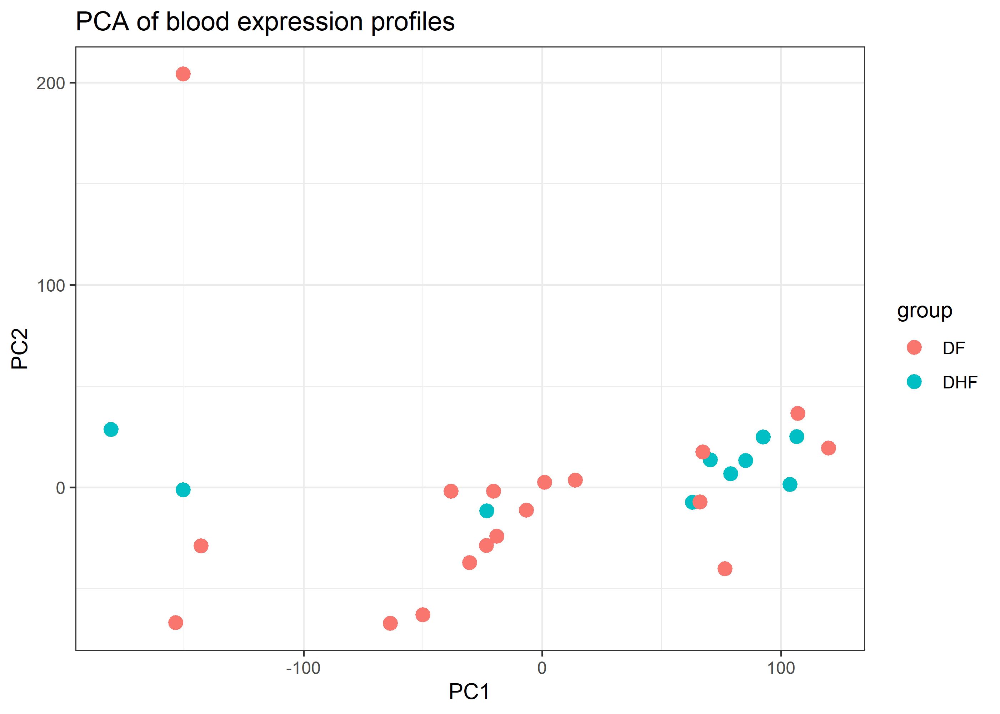
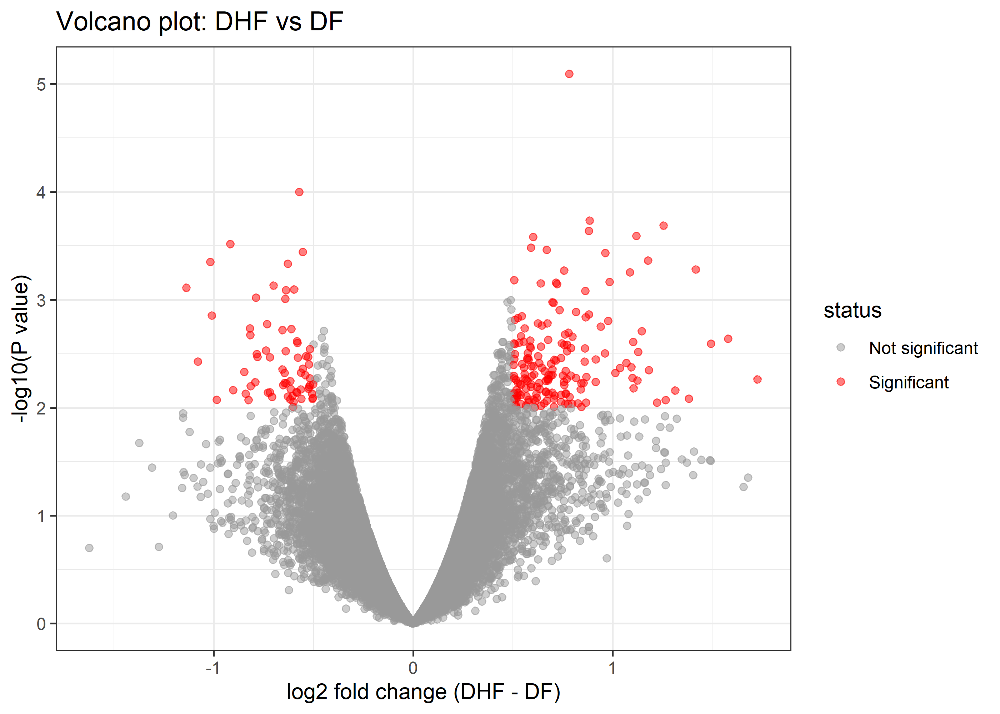
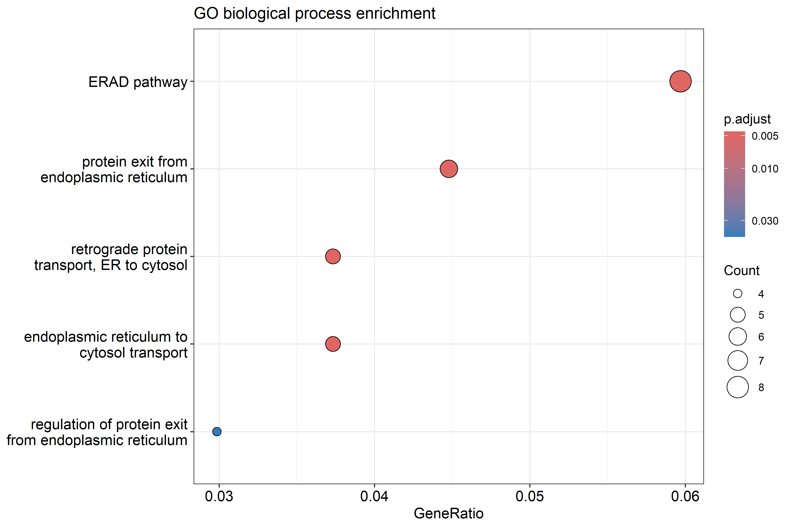
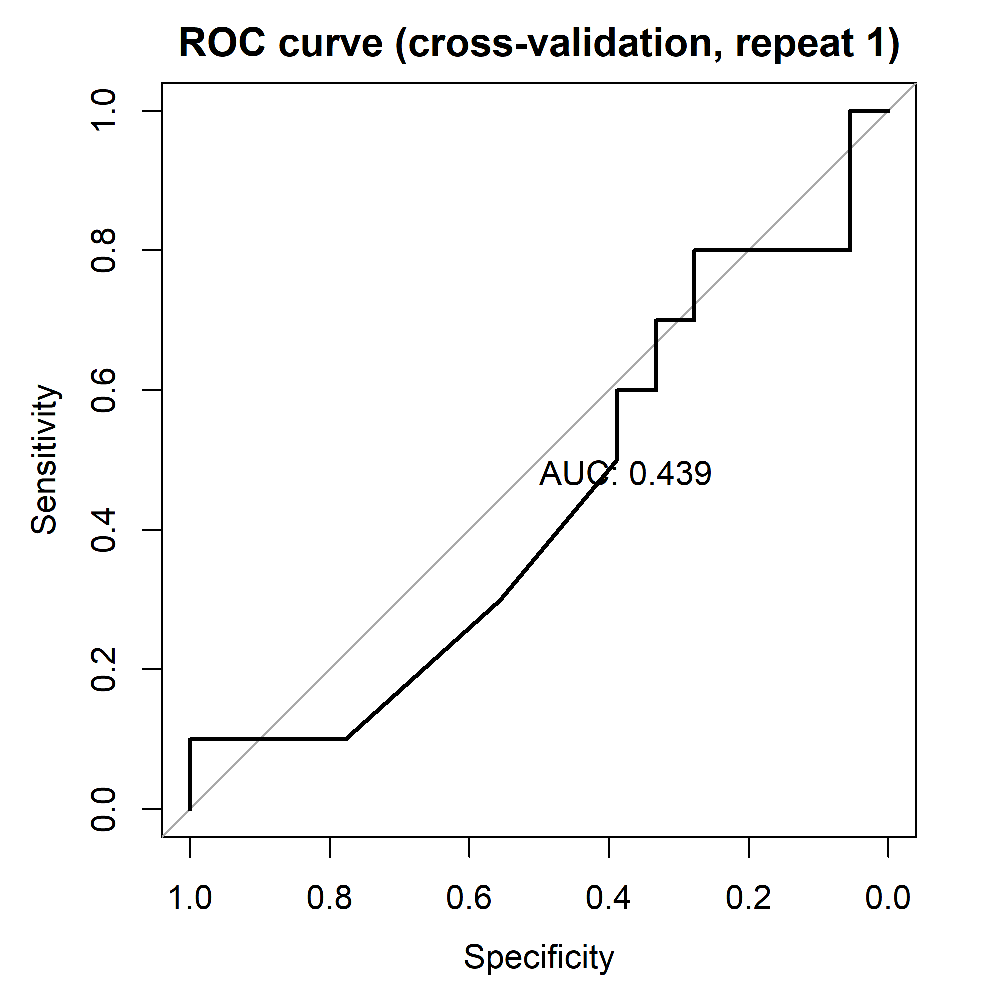

# Can a minimal whole-blood gene panel distinguish severe from non-severe dengue? A negative result from a public cohort

**Student:** M. I. Izla (Reg. No. 2021/ICT/30), BSc (Hons) Information Technology, University of Vavuniya
**Assessment:** Bioinformatics ICA3, 2026

## 1. Abstract

Severe dengue (dengue haemorrhagic fever, DHF) is hard to distinguish from uncomplicated dengue fever (DF) early in illness. I asked whether a small whole-blood gene panel could separate the two, a question relevant to resource-limited hospitals such as those in Sri Lanka. Using public microarray data (GEO: GSE51808; 18 DF and 10 DHF acute-phase patients), I performed quality control, limma differential expression, Gene Ontology enrichment and a LASSO classifier with repeated cross-validation in R. No probe passed multiple-testing correction (smallest adjusted p = 0.22). At an exploratory threshold, 241 probes were selected and were enriched for endoplasmic reticulum protein-processing terms. The classifier performed at chance level (mean AUC 0.52, 95% interval 0.39-0.68) and retained no genes. The hypothesis of a compact, accurate panel was therefore not supported in this small cohort.

## 2. Introduction

Dengue is a mosquito-borne viral disease that infects hundreds of millions of people each year (Kwissa et al., 2014). Most infections are mild, but a minority progress to severe disease, historically classified as dengue haemorrhagic fever (DHF) and characterised by plasma leakage, bleeding and shock (WHO, 2009). Sri Lanka has had recurring dengue epidemics for many years, and hospitals in affected districts regularly face surges of febrile patients.According to the National Dengue Control Unit, Sri Lanka recorded nearly 50,000 cases and 24 deaths in 2024, and more than 52,000 cases and 31 deaths by the end of June 2026 (Xinhua, 2025; Xinhua, 2026).

The clinical problem is timing. Patients usually present in the early febrile phase, when DF and DHF look alike, while deterioration tends to happen later, around the fall of fever. Clinicians therefore depend on warning signs and repeated monitoring, which strains crowded wards. A blood test that flagged likely severe disease early could help triage patients. Genome-wide expression profiling has revealed host-response signals in dengue, but microarrays and RNA sequencing are not practical in district hospitals. A realistic test would be a small panel of fewer than ten genes measured by quantitative RT-PCR.

This project asks whether acute-phase whole-blood expression data can separate DHF from DF, and how few genes are needed to do so.

**Hypothesis:** a sparse classifier using fewer than ten genes can discriminate DHF from DF with a cross-validated area under the ROC curve (AUC) above 0.80.

## 3. Data

| Item | Description |
|---|---|
| Source | NCBI Gene Expression Omnibus (GEO), series **GSE51808**, "Systems biological analysis of immunity to dengue" (Kwissa et al., 2014), released 27 June 2014 |
| Organism and tissue | *Homo sapiens*, whole blood |
| Platform | GPL13158 (Affymetrix HT HG-U133+ PM array) |
| Total size | 56 samples x 54,715 probes |
| Patients | Hospitalised at Siriraj Hospital, Bangkok, 2009; blood taken 2-9 days after symptom onset |
| Groups | 28 acute (18 DF, 10 DHF); 19 convalescent (13 DF, 6 DHF) from the same patients; 9 healthy donors |
| Variables | log2 expression of each probe; disease group (DF, DHF, healthy); phase (acute, convalescent) |

I used only the **28 acute samples**. Convalescent samples were excluded because they come from the same patients as acute samples, which would break the independence needed for honest cross-validation. Healthy donors were excluded because the question concerns severity among patients.

**Ethics and licence:** the data are public and de-identified, and I only reanalysed them; ethical approval and consent were handled by the original study. GEO data are freely available and are cited here as required.

## 4. Methods

All analysis was done in R 4.6.1 (code in `code/analysis.Rmd`).

1. **Import and grouping.** The series matrix was downloaded with GEOquery (Davis and Meltzer, 2007). Sample labels were parsed to define severity (DF or DHF) and phase, and only acute DF and DHF samples were kept (n = 28).
2. **Quality control.** I checked that values were on a log2 scale and for missing values (none), and compared boxplots of each sample before and after quantile normalisation (Bolstad et al., 2003; `normalizeBetweenArrays` in limma). The least variable half of probes was removed with an unsupervised variance filter, leaving 27,357 probes. This reduces the multiple-testing burden without using group labels.
3. **Exploratory analysis.** Principal component analysis (PCA), a heatmap of the 50 most variable probes (pheatmap) and hierarchical clustering of samples.
4. **Differential expression.** limma (Ritchie et al., 2015) fitted a linear model with empirical Bayes moderation (DHF minus DF). P-values were adjusted by the Benjamini-Hochberg method (Benjamini and Hochberg, 1995). The planned threshold was adjusted p < 0.05 and |log2 fold change| > 0.5. Because this gave fewer than 20 probes, I also used an **exploratory** threshold of nominal p < 0.01 and |log2 fold change| > 0.5. This choice was made after seeing the strict result, so the exploratory list must be treated cautiously.
5. **Enrichment.** Gene Ontology biological process enrichment with clusterProfiler (Yu et al., 2012; Wu et al., 2021), using all annotated genes on the array as background and Benjamini-Hochberg adjustment.
6. **Classification.** LASSO logistic regression (Tibshirani, 1996) was fitted with glmnet (Friedman et al., 2010) on the 5,000 most variable probes (chosen without group labels). It was evaluated by 20 repeats of stratified 5-fold cross-validation (caret; Kuhn, 2008). Within every training fold the penalty was tuned by an inner 5-fold cross-validation, so gene selection never saw the test samples. Predictions were scored at the penalty that minimises cross-validated error (`lambda.min`), and the AUC (pROC; Robin et al., 2011) was computed for each repeat. A final model on all 28 samples used the more conservative `lambda.1se` to define the gene panel. The random seed was 2026.

LASSO was chosen because it selects few genes, matching the aim of a minimal panel, and nested cross-validation avoids the optimistic bias that arises when genes are selected on all the data first.

## 5. Results

### 5.1 Quality control and exploratory analysis

After quantile normalisation the sample boxplots lined up at a similar level, showing that technical differences between arrays were removed (Supplementary Figure S1). The PCA showed extensive overlap between DF and DHF samples and no clear separation by severity (Figure 1). The heatmap of the 50 most variable probes and the sample dendrogram did not group samples by severity, with DF and DHF samples interspersed (Supplementary Figures S2 and S3).

*Figure 1. PCA of acute-phase samples (18 DF, 10 DHF) after normalisation and filtering.*

### 5.2 Differential expression

After filtering, 27,357 probes were tested. **No probe remained significant after multiple-testing correction** (smallest adjusted p = 0.22). At the exploratory threshold, 241 probes were selected: 174 higher and 67 lower in DHF. The probes with the smallest p-values corresponded to *EHD3*, *PAK6*, *CCL25*, *MOXD1* and *SEC24D* (Table 1, Figure 2).

*Figure 2. Volcano plot of DHF (n = 10) versus DF (n = 18). Each point is a probe; red points passed the exploratory threshold (nominal p < 0.01, |log2FC| > 0.5).*

*Table 1. Top probes by p-value (DHF vs DF).*

| Gene | log2FC | P value | Adj. P |
|---|---|---|---|
| EHD3 | 0.78 | 8.1e-06 | 0.22 |
| PAK6 | -0.57 | 1.0e-04 | 0.73 |
| CCL25 | 0.89 | 1.9e-04 | 0.73 |
| MOXD1 | 1.26 | 2.1e-04 | 0.73 |
| SEC24D | 0.88 | 2.3e-04 | 0.73 |
| MGLL | 1.12 | 2.6e-04 | 0.73 |
| PSEN2 | 0.60 | 2.6e-04 | 0.73 |
| HDGFRP3 | -0.92 | 3.1e-04 | 0.73 |
| MGAT3 | 0.67 | 3.4e-04 | 0.73 |

### 5.3 Pathway enrichment

The 241 probes corresponded to 185 unique genes, of which 134 had GO annotations. Five biological process terms were enriched (adjusted p < 0.05), all concerning protein handling in the endoplasmic reticulum (ER): ER-associated degradation (ERAD) pathway, protein exit from the ER, retrograde protein transport from ER to cytosol, ER-to-cytosol transport, and regulation of protein exit from the ER (Figure 3, Table 2). These terms share many genes and so represent one theme, not five independent findings.

*Figure 3. GO biological process enrichment of the exploratory gene list. Dot size shows gene count and colour shows adjusted p-value.*

*Table 2. Enriched GO terms.*

| GO term | Genes | Adj. P |
|---|---|---|
| ERAD pathway | 8/134 | 0.005 |
| Protein exit from endoplasmic reticulum | 6/134 | 0.005 |
| Retrograde protein transport, ER to cytosol | 5/134 | 0.005 |
| Endoplasmic reticulum to cytosol transport | 5/134 | 0.005 |
| Regulation of protein exit from endoplasmic reticulum | 4/134 | 0.042 |

### 5.4 Classification

The LASSO classifier did not discriminate DHF from DF. The mean cross-validated AUC was **0.52** (95% interval across repeats 0.39-0.68), indistinguishable from chance (AUC = 0.5) (Figure 4). When fitted on all samples with `lambda.1se`, LASSO retained **no probes**, so no minimal gene panel could be defined.

*Figure 4. ROC curve for DHF versus DF from repeat 1 of the cross-validation. The diagonal marks random guessing (AUC = 0.5).*

## 6. Discussion

**Main finding.** The hypothesis was not supported. Two independent analyses agree: no individual gene survived correction for multiple testing, and a classifier built with careful cross-validation performed at chance level and kept no genes. In this cohort, acute whole-blood expression does not separate DHF from DF well enough to define a compact panel.

**The ER theme.** The five enriched terms point to ER protein quality control. This is biologically plausible, because dengue virus replicates on ER-derived membranes, the ER supports several stages of the flavivirus life cycle (Verhaegen and Vermeire, 2024), and dengue-related ER stress triggers the unfolded protein response (Perera et al., 2017). However, the result must be read with caution. About 1% of the 27,357 probes tested (roughly 270) would have p < 0.01 by chance alone, and I found 241 even after adding a fold-change filter. The gene list is therefore indistinguishable from what noise would produce, and the enrichment test corrects for the number of GO terms but not for noise in the input list. The ER theme is a hypothesis for future testing, not evidence of a mechanism.

**Limitations.**
- *Small sample:* only 28 patients (10 DHF), giving low statistical power and wide uncertainty (the AUC interval spans 0.39 to 0.68).
- *Single site and season:* one hospital in Bangkok in 2009, so results may not transfer to Sri Lanka.
- *Heterogeneous sampling time:* samples were taken 2-9 days after onset, a period in which the immune response changes quickly. I could not adjust for day of illness, age, sex or serotype.
- *Whole blood:* expression reflects a mixture of cell types, and changes in cell proportions may mask gene-level signals.
- *Analytical choices:* the exploratory threshold was chosen after the strict one gave few probes. Predictions were scored at `lambda.min` while the panel used `lambda.1se`. Several probes can map to one gene.
- *No external validation:* I did not test on an independent dataset.

**Implications.** For a district hospital, these data give no support for a gene-expression triage test. Cheap clinical indicators, such as warning signs, platelet count and haematocrit, remain the practical basis for monitoring. The result is also useful as a caution: an apparently promising gene list from a small study can easily be noise.

## 7. Conclusion and future work

Using public data from 28 acute dengue patients, I found no reliable gene-expression difference between DF and DHF and could not build a classifier better than chance, so a minimal blood-gene panel was not supported. The enrichment of ER protein-processing pathways is an interesting but unconfirmed lead. Future work should (1) use larger multi-site cohorts, including Sri Lankan samples, (2) sample early in illness, before the critical phase, (3) validate findings on independent GEO datasets, (4) combine expression with clinical variables, and (5) test any candidate genes by targeted RT-PCR.

## 8. Reproducibility

**Requirements:** R 4.6.1 and RStudio; Bioconductor 3.23. Package versions: tidyverse 2.0.0, ggplot2 4.0.3, dplyr 1.2.1, glmnet 5.2, caret 7.0-1, pROC 1.19.1, rmarkdown 2.32, knitr 1.52, GEOquery 2.80.1, limma 3.68.5, clusterProfiler 4.20.3 (full list: `sessionInfo()` at the end of the HTML report).

**To run:**
1. Clone this repository and open `code/analysis.Rmd` in RStudio.
2. Install the packages:
   `install.packages(c("tidyverse","pheatmap","glmnet","caret","pROC","rmarkdown","knitr","BiocManager"))`
   `BiocManager::install(c("GEOquery","limma","clusterProfiler","org.Hs.eg.db","enrichplot"))`
3. Click **Knit**. The data are downloaded automatically from GEO (internet required). The run takes a few minutes.

**Repository contents:** `code/analysis.Rmd` and rendered `code/analysis.html`; `figures/` (all plots); `results/` (`DEG_table.csv`, `GO_enrichment.csv`, `panel_genes.csv`). The random seed is fixed (2026).

## 9. References

Benjamini, Y. and Hochberg, Y. (1995) 'Controlling the false discovery rate: a practical and powerful approach to multiple testing', *Journal of the Royal Statistical Society: Series B*, 57(1), pp. 289-300.

Bolstad, B.M. et al. (2003) 'A comparison of normalization methods for high density oligonucleotide array data based on variance and bias', *Bioinformatics*, 19(2), pp. 185-193.

Davis, S. and Meltzer, P.S. (2007) 'GEOquery: a bridge between the Gene Expression Omnibus (GEO) and BioConductor', *Bioinformatics*, 23(14), pp. 1846-1847.

Friedman, J., Hastie, T. and Tibshirani, R. (2010) 'Regularization paths for generalized linear models via coordinate descent', *Journal of Statistical Software*, 33(1), pp. 1-22.

Kuhn, M. (2008) 'Building predictive models in R using the caret package', *Journal of Statistical Software*, 28(5), pp. 1-26.

Kwissa, M. et al. (2014) 'Dengue virus infection induces expansion of a CD14+CD16+ monocyte population that stimulates plasmablast differentiation', *Cell Host & Microbe*, 16(1), pp. 115-127. Dataset: GEO accession GSE51808. Available at: https://www.ncbi.nlm.nih.gov/geo/query/acc.cgi?acc=GSE51808

Perera, N., Miller, J.L. and Zitzmann, N. (2017) 'The role of the unfolded protein response in dengue virus pathogenesis', *Cellular Microbiology*, 19(5), e12734.

R Core Team (2026) *R: a language and environment for statistical computing*. Vienna: R Foundation for Statistical Computing.

Ritchie, M.E. et al. (2015) 'limma powers differential expression analyses for RNA-sequencing and microarray studies', *Nucleic Acids Research*, 43(7), e47.

Robin, X. et al. (2011) 'pROC: an open-source package for R and S+ to analyze and compare ROC curves', *BMC Bioinformatics*, 12, 77.

Tibshirani, R. (1996) 'Regression shrinkage and selection via the lasso', *Journal of the Royal Statistical Society: Series B*, 58(1), pp. 267-288.

Verhaegen, M. and Vermeire, K. (2024) 'The endoplasmic reticulum (ER): a crucial cellular hub in flavivirus infection and potential target site for antiviral interventions', *npj Viruses*. doi:10.1038/s44298-024-00031-7.

Wickham, H. et al. (2019) 'Welcome to the tidyverse', *Journal of Open Source Software*, 4(43), 1686.

World Health Organization (2009) *Dengue: guidelines for diagnosis, treatment, prevention and control*. Geneva: WHO.

Wu, T. et al. (2021) 'clusterProfiler 4.0: a universal enrichment tool for interpreting omics data', *The Innovation*, 2(3), 100141.
Xinhua (2025) 'Over 40,000 dengue cases reported in Sri Lanka in 2025', The Star, 22 October. Available at: https://www.thestar.com.my/aseanplus/aseanplus-news/2025/10/22/over-40000-dengue-cases-reported-in-sri-lanka-in-2025

Xinhua (2026) 'Sri Lanka dengue cases pass 52,000, DENV-2 identified as primary strain', Bernama, 29 June. Available at: https://web29.bernama.com/nnn/news.php?id=2574578

Yu, G. et al. (2012) 'clusterProfiler: an R package for comparing biological themes among gene clusters', *OMICS*, 16(5), pp. 284-287.